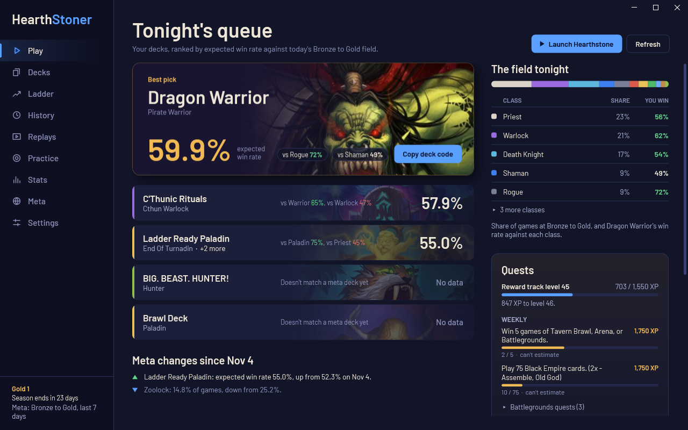
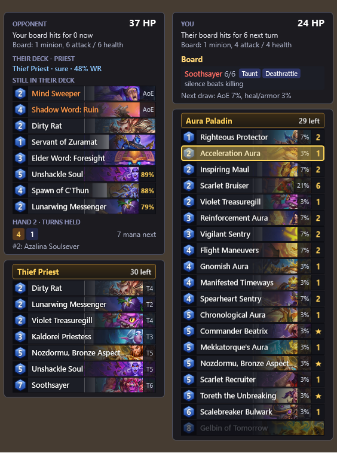
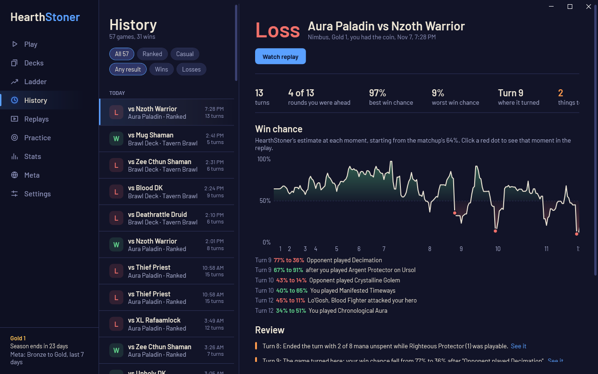
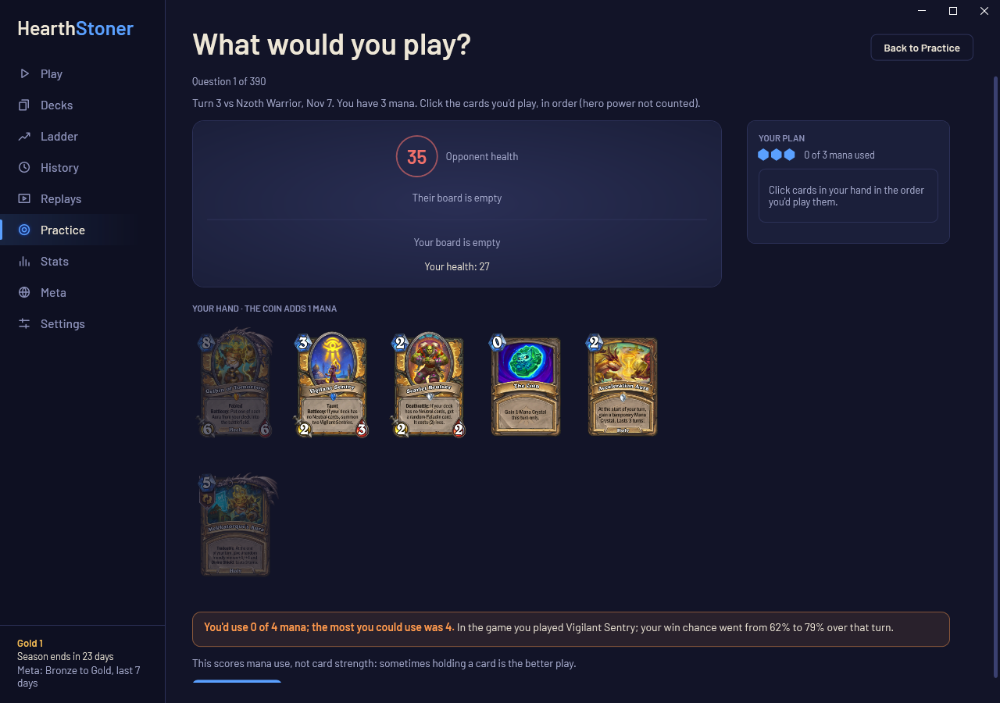
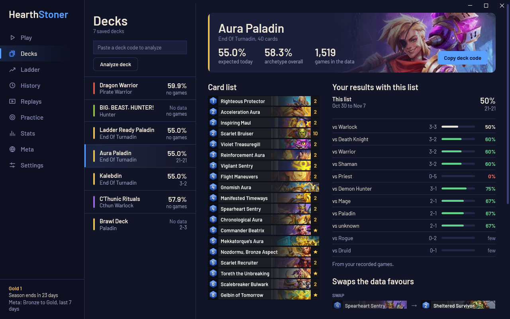
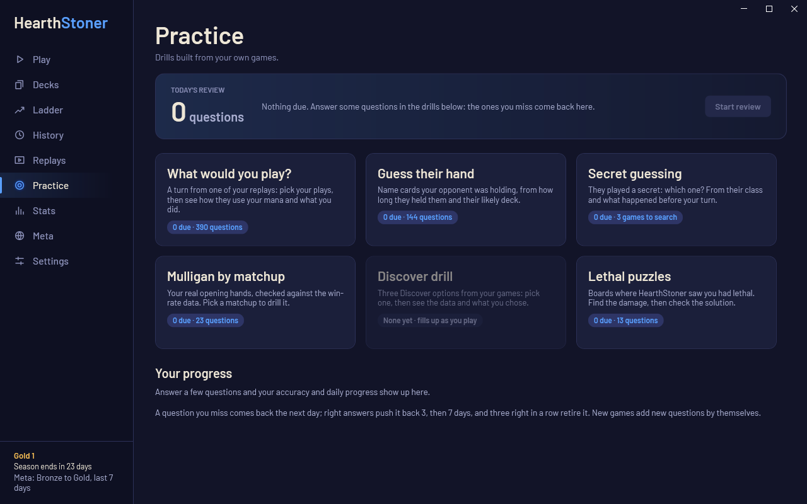
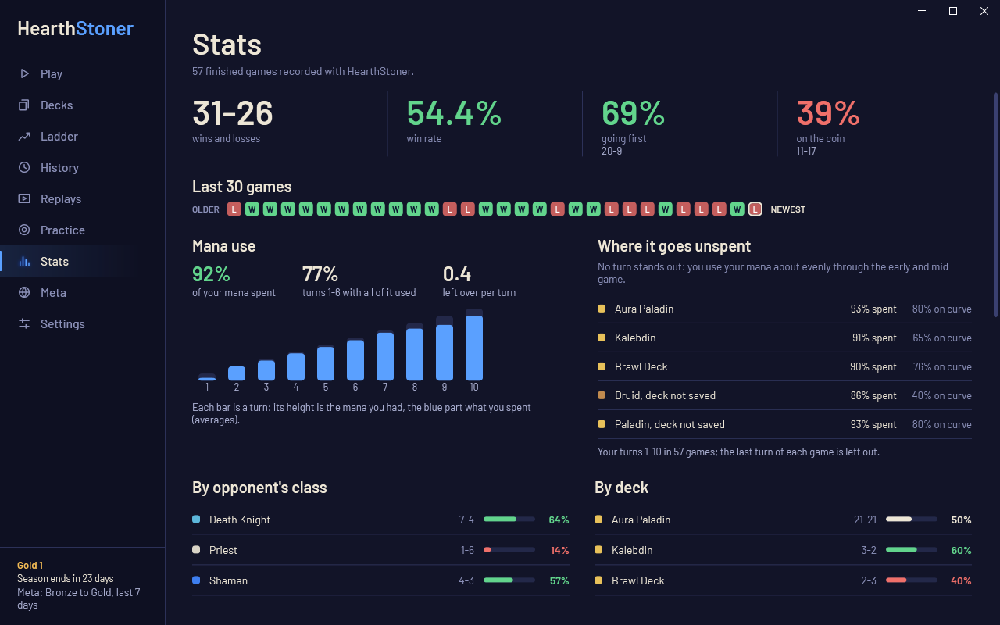

# HearthStoner

[](https://github.com/bucckevin/HearthStoner/releases/latest)
[](https://github.com/bucckevin/HearthStoner/actions/workflows/ci.yml)

A Hearthstone tracker and coach for Windows. It shows an overlay with advice while you play, records every game,
and lets you replay your games, see where they turned, practise on your own mistakes and pick the deck most likely
to win against today's field. It's a desktop app (a window, a tray icon and the in-game overlay) with a command line
for the same features.



## What it does

- **In-game overlay:** your deck with draw odds, the opponent's likely deck and hand, secrets, mulligan advice from
  real win rates, lethal checks, threats and answers.
- **Deck picks:** your decks ranked by expected win rate against the decks people play at your rank today.
- **History and replays:** every game saved, with a win-chance graph that marks the turning points, a review of
  likely mistakes, and a replay you can step through.
- **Practice:** drills built from your own games, with a daily review that brings back the questions you missed.
- **Stats and ladder:** win rates by deck and matchup, mana use, tilt patterns, and your climb this season.
- **Updates itself** from this repository's releases.

| | |
|---|---|
|  |  |
| The overlay (opponent on the left, you on the right) | History: the win-chance graph and the review |
|  |  |
| Practice: "What would you play?" from a turn of your own game | Decks: your results with a list and the swaps the data favours |

## Download and install

1. Download `HearthStoner.exe` from the [latest release](https://github.com/bucckevin/HearthStoner/releases/latest)
   and double-click it.
2. Windows may warn about an unknown publisher (the exe isn't code-signed yet): choose **More info**, then
   **Run anyway**.
3. HearthStoner offers to install itself for your Windows user, with Start menu and desktop shortcuts. No admin
   rights needed, and nothing else to install (.NET is built into the exe, which is why it's about 75 MB).
4. **Restart Hearthstone once** after the first start. HearthStoner turns on the game's log, which Hearthstone only
   picks up when it starts.
5. Play with Hearthstone **windowed or in borderless fullscreen**, so the overlay can sit on top.

HearthStoner checks for a new version once a day and offers it in Settings and in the tray menu. It installs when
you're not in a game.

**Requirements:** Windows 10 or 11, 64-bit.

**Uninstall:** Windows Settings > Apps > HearthStoner > Uninstall. Your games and settings stay in
`%LocalAppData%\HearthStoner`; delete that folder too if you want them gone.

## The app

HearthStoner sits in the tray near the clock. Its menu has Open, Overlay on/off, Start with Windows, Quit, and
"Update to x.y.z" when a new version is out. The overlay appears whenever Hearthstone is in front.

The window fits any screen: in a small window the pages stack into one column, a normal window gets two, and a
maximized window on a 1920 px or ultrawide screen gets three side by side (centred on very wide screens so nothing
stretches across the whole monitor). Settings has a **text size** (90% to 150%) for big or far-away screens, and the
window opens where you left it. Ctrl+1 to Ctrl+9 jump to the pages in menu order. It has nine pages:

- **Play:** a button to start Hearthstone through the Battle.net app (it turns into "Switch to Hearthstone" while
  the game runs). Then your decks, ranked by expected win rate against today's field at your rank, the best one as
  a banner with a button to copy its deck code. On the right: the field's class mix with your win rate against each
  class, your quests, and what to craft next. Under your decks, **meta changes**: decks whose expected win rate
  moved by 1.5 points or more, or archetypes whose share of games changed noticeably, since a few days ago.
- **Decks:** each deck's card list, your results with it by class, the swaps the data favours (for example a card
  that wins 41% of games when drawn for one that wins 55%), and how your list differs from the best list of its
  archetype, with the dust to build it. Paste any deck code to analyze it the same way. **Versions:** every list
  you've played a deck with, its record, and what changed from the version before.
- **Ladder:** where you stand, the season's climb chart with the rank floors, your pace before the reset, the deck
  that climbs fastest per hour, star bonus and streaks, your opponents' ranks, this session, and your best time to
  play.
- **History:** every recorded game, filtered by ranked, casual, wins or losses, with its result, key numbers, your
  mulligan, the review, and the **win-chance graph**: an estimate at every moment from health, boards, hands,
  unspent mana and lethal threats, starting from the matchup's win rate. The biggest drops are marked and open the
  replay at that moment.
- **Replays:** step through any recorded game without Hearthstone: both boards, hands, mana, secrets, what
  HearthStoner advised that turn, and a timeline with the turning point and review notes. Left/Right step,
  Up/Down jump a turn, Space plays. The board, frames and effects are drawn with art read from your own
  Hearthstone install (built in the background; Settings can rebuild it after a patch).
- **Practice:** a daily review (questions you missed come back the next day, then after 3 and 7 days; three right
  in a row retire one) and six drills from your own games: What would you play?, Guess their hand, Secret guessing,
  Mulligan by matchup, Discover picks and Lethal puzzles. **Your progress** shows the questions you answered on each
  of the last two weeks' days and how often you're right in each drill.
- **Stats:** your record, going first and on the coin, the last 30 games, **mana use** (how much you spend, the
  turns you leave mana unspent, by deck), results by opponent class and by deck, mulligan habits and tilt notes.
- **Meta:** every archetype at your rank with its play rate and win rate, by class or in one list, with search and
  sorting. Your archetypes are marked.
- **Settings:** text size and whether the window remembers its size and place, overlay layout and panels, the
  replay board, the meta rank bracket and period, which program starts Hearthstone, start with Windows, updates,
  your collection, and the hotkeys. Saved as you change them.



## The in-game overlay

A click-through panel on each side of the Hearthstone window. Where they go (both right, both left, or split) is a
setting.

- **Health and damage:** effective health (health plus armor) for both heroes, what each board can hit for (Charge,
  Windfury, weapons, frozen minions and Taunts counted), your burn in hand added for a lethal check, their likely burn
  that would make it lethal, and a fatigue warning.
- **Opponent:** their most likely archetypes from the cards they've shown and how popular each one is, the cards they
  probably still hold (board clears flagged), and each card in their hand with where it came from (kept in the
  mulligan, drawn, created by a card, returned) and how long they've held it.
- **Secrets:** what a hidden secret can still be. Candidates are ruled out as you do things that would have triggered
  them, and each comes with advice on playing around it.
- **Mulligan:** keep or toss each card, from real win-rate-when-kept stats for your archetype in this matchup.
- **Board:** lethal checks, a warning when their board can kill you, their biggest threats with notes ("Divine Shield:
  ping it first"), which cards or trades answer each one, and board clears to play around.
- **Your deck:** a deck-tracker list with each card's mana cost, art and count, dimmed when every copy is drawn, plus
  each card's chance to be your next draw, and the chance your next draw is removal, AoE, healing or card draw.

Extras:

- **This turn:** the ways to spend all your mana with the cards you can play right now, plus your hero power.
- **Discover:** the win rate of each option when picked by players of your archetype.
- **Opponent's hand marks:** over each card in their hand, the turn they got it, `Mull` (from their opening hand),
  `Coin`, `New` (created by another card), `Back` (returned to their hand) or `Yours` (stolen from you).
- **Opponent played:** every card they've played, with the turn and whether it was created by another card.
- **Reads:** inferences from public information, like "they floated 3 mana with 5 cards, so they're likely holding
  reactive or expensive cards".
- **Lethal through Taunts:** whether your attacks and damage spells can clear the Taunts and still reach face, and
  exactly which minion or spell goes where. Hero powers that hit face count.
- **Outs:** when their board threatens lethal, the cards left in your deck that would save you and the chance of
  drawing one next.
- **Matchup cheat sheet** (mulligan and early turns): your win rate in this matchup, your best and weakest cards in it,
  and the enemy archetype's key cards.
- **Counters:** spells cast, minions died, corpses and the like, only when cards in your deck care about them.
- **Hover mode:** press Ctrl+Shift+M and point at a card to see the full card. Press it again to give the mouse back.

**Hotkeys** (while Hearthstone is in front): Ctrl+Shift+H shows or hides the overlay, Ctrl+Shift+D the deck list,
Ctrl+Shift+O the opponent panels, Ctrl+Shift+A the advice, Ctrl+Shift+M hover mode. Change them in
`%LocalAppData%\HearthStoner\settings.json` (Settings has a button to open it); everything else is on the Settings
page.

## Games, reviews and practice

Every game played while HearthStoner runs is saved to `%LocalAppData%\HearthStoner\games\`: your deck, the opponent's
class and likely archetype, the result, rank, mulligan, Discover picks and a snapshot of every turn, plus the game's
log so it can be replayed. After each game, a review lists likely mistakes:

- possible missed lethal
- ending a turn with unspent mana while a card was playable
- overextending into a board clear that HearthStoner had flagged as likely
- mulligan choices against the data, and Discover picks that win less than another option
- secrets you ran into
- cards held for four or more turns while affordable, and the hero power left unused with mana to spare
- trades where your minion died and theirs survived
- attacking face when their board could kill you, and dying the next turn
- where the win chance fell the most



## What goes online

- **Card data** from [HearthstoneJSON](https://hearthstonejson.com) (names, text, art), cached on your PC.
- **Meta stats** from [Firestone](https://www.firestoneapp.com)'s public Constructed data (archetypes, mulligan and
  draw win rates, matchups), refreshed every 3 hours.
- **Update checks** against this repository's GitHub releases, once a day (turn off "Check for updates" in Settings).

Nothing about you or your games is uploaded. Everything HearthStoner records stays in `%LocalAppData%\HearthStoner`.

## Troubleshooting

- **No games are recorded:** restart Hearthstone once after installing HearthStoner, so the game starts writing its
  log. HearthStoner also raises the log's 10 MB limit, which otherwise stops tracking after a few games.
- **The overlay doesn't show:** play windowed or in borderless fullscreen, and check Overlay is ticked in the tray
  menu (Ctrl+Shift+H toggles it).
- **Collection, decks, quests or ranks are empty after a Hearthstone patch:** memory reading usually breaks on
  patches. See [When a Hearthstone patch breaks something](#when-a-hearthstone-patch-breaks-something).
- **What happened:** the app's log is `%LocalAppData%\HearthStoner\hearthstoner.log`.

## Command line

The same features, from a terminal (`HearthStoner help` lists them all):

```
HearthStoner app [--minimized]              # the full app: tray icon, overlay and window
HearthStoner install | uninstall | update   # install for your user, remove (keeps your data), install the latest release
HearthStoner update --check                 # just say whether a newer version is out
HearthStoner setup                          # turn on Hearthstone's game log (the app does this by itself)
HearthStoner collection [--csv F] [--json F] # every card you own, read from the game
HearthStoner decks                          # your saved decks, each with a deck code to paste into the game
HearthStoner status                         # account, current screen, current match and ranks
HearthStoner overlay                        # just the overlay; Ctrl+C to stop
HearthStoner watch --tips                   # play-by-play and advice in the console, every turn
HearthStoner meta [--class C]               # today's Standard archetypes: popularity and win rate
HearthStoner stats                          # win rates vs the meta, mulligan habits, tilt check, games to next rank
HearthStoner review 3                       # review of your last 3 games
HearthStoner puzzles | quiz | quests        # lethal puzzles, mulligan quiz, your quests
HearthStoner import-logs                    # keep the logs of past games for replays
HearthStoner launch [--dry-run]             # start Hearthstone through Battle.net
HearthStoner gameart                        # build the replay art from your Hearthstone install now
HearthStoner selftest                       # check HearthStoner against your own game logs
HearthStoner --version
```

Options: `--rank` and `--period` pick the meta stats (for example `--rank legend --period last-patch`), `--hs PATH`
points at the Hearthstone folder if it isn't found, and `--verbose` shows the memory reader's log.

## Disclaimer

HearthStoner is a fan-made tool. It isn't made, endorsed or supported by Blizzard Entertainment. Hearthstone is a
trademark of Blizzard Entertainment, and the card and game art HearthStoner shows belongs to Blizzard.

It only uses information you're allowed to see: the game log your client writes, your own client's state and public
meta stats. It never reads the opponent's hidden information, never writes to the game, and never sends input to it
or automates play. Reading log files is what Blizzard expects trackers to do. Reading memory read-only is how
Hearthstone Deck Tracker and Firestone work, and Blizzard has tolerated it for years, but it isn't officially
approved. Use HearthStoner at your own risk.

Game art for replays is read from your own Hearthstone install and stays on your PC; none is shipped with
HearthStoner.

## Credits

- [HearthstoneJSON](https://hearthstonejson.com): card data and art.
- [Firestone](https://www.firestoneapp.com): meta stats.
- [UnitySpy](https://github.com/Zero-to-Heroes/unity-spy-.net4.5) (MIT), maintained by the Firestone team: memory
  reading, included in `vendor/` (see `vendor/LICENSE-UnitySpy.txt`).
- [Barlow](https://github.com/jpt/barlow) (SIL Open Font License): the app's fonts, in `App/Fonts`.

---

## For developers

### Build and test

You need the [.NET 10 SDK](https://dotnet.microsoft.com/download). Double-click `build.bat` (output in `build.log`),
or:

```
dotnet build HearthStoner.slnx -c Release
dotnet test HearthStoner.slnx -c Release
```

The exe lands in `bin\Release\net10.0-windows\HearthStoner.exe`. `install.bat` builds the single self-contained exe
(the publish settings are in `HearthStoner.csproj`) and installs it.

- **Two groups of tests.** `--filter Category!=MyGames` runs the fixed tests (same inputs every time).
  `--filter Category=MyGames` replays your own logs and saved games, which grow as you play: recording each game
  again must give the same result, length, classes and turn-by-turn boards, replays must obey the game's limits, and
  the win chance and review must hold up. A Hearthstone patch that changes the log fails here after your first game
  on it.
- **On Windows** the tests use your real HearthStoner data and Hearthstone logs. **On Linux or macOS**,
  `tests/run.sh` builds everything (including the Windows app) and runs the tests; it installs the .NET 10 SDK into
  `/opt/dotnet` if it's missing. Test data goes in `tests/data`: copies of `%LocalAppData%\HearthStoner` under
  `tests/data/appdata/HearthStoner`, and Hearthstone's `Logs\Hearthstone_*` folders under `tests/data/install/Logs`.
- `HearthStoner screenshot [folder]` draws every page of the app to PNGs (at 1280x800, and again in a small window,
  the narrowest wide window, 1920 and 3440 px wide), and `HearthStoner preview [out.png] [--log Power.log]
  [--turn N]` draws the overlay at a turn of a saved game. `build.bat` makes `screenshots\preview.png` after every
  build. With `HEARTHSTONER_SCREENSHOT_ANON=1` the screenshots leave your name off the menu (the README's pictures
  are made that way).

### Releases

The version is in `VERSION` (major.minor.patch: patch for fixes, minor for features), with an entry in
`CHANGELOG.md` and a git tag `v<number>` for each. Pushing the tag runs `.github/workflows/release.yml`: it checks
the tag, `VERSION` and the changelog agree, builds, tests, and publishes `HearthStoner.exe` and its SHA-256 as a
GitHub release with that version's changelog section as the notes. Installed copies pick it up within a day.
`ci.yml` builds and tests every push and pull request, and Dependabot proposes package and workflow updates weekly.

### Projects

| Project | What's in it |
|---|---|
| `HearthStoner.csproj` (Windows, .NET 10) | The command line (`Program.cs`, commands in `Cli/`), the overlay (`Overlay/`), the tray app, window and updater (`App/`, pages in `App/Pages/`), replay art (`Art/`) |
| `Core/HearthStoner.Core.csproj` (.NET 10, any OS) | All the logic: `Game/` (rebuilding the game from the log), `Advice/`, `Meta/`, `Knowledge/` (card profiles, secrets), `Stats/` (records, reviews, practice), `Live/` (the live pipeline and memory), plus deck codes, card data, settings and updates. Each folder is its own namespace |
| `vendor/UnitySpy.csproj` | UnitySpy, the memory reader (MIT) |
| `tests/HsTest/HsTest.csproj` | xUnit tests |

When Standard rotates (each March), update `CardDb.StandardSets` and `Core/Knowledge/Secrets.cs`.

### How memory reading works

Hearthstone is a Unity game running on the Mono runtime. UnitySpy opens the process **read-only**, finds Mono's root
domain through `mono_get_root_domain` in `mono-2.0-bdwgc.dll`, and walks to the `Assembly-CSharp` image. From there
it reads classes, static fields and object fields using Mono's own metadata. Nothing is injected or written.

| Data | Path in memory |
|---|---|
| Collection | `CollectionManager.s_instance.m_collectibleCards` (each card: `m_EntityDef.m_cardIdInternal`, `<OwnedCount>k__BackingField`, `m_PremiumType`) |
| Decks | `CollectionManager.s_instance.m_decks` (`keySlots` = deck ids, `valueSlots` = decks with `m_name`, `m_slots`, `<HeroCardID>k__BackingField`) |

`HearthStoner find <text>` searches Hearthstone's class names, and `HearthStoner explore CollectionManager.s_instance`
shows an object's live fields.

### When a Hearthstone patch breaks something

HearthStoner warns when the Hearthstone client build changes, and once a day checks whether the Firestone team has
published a newer UnitySpy.

1. Compare `vendor/UNITYSPY_COMMIT.txt` with the latest commit at
   https://github.com/Zero-to-Heroes/unity-spy-.net4.5 . If it moved, copy the new `UnitySpy` and
   `UnitySpy.HearthstoneLib` folders into `vendor/`.
2. Or fix it yourself: `HearthStoner explore CollectionManager.s_instance` shows the live field names; update the path
   in `Core/HsMemory.cs` or the vendored reader.
3. Run `HearthStoner selftest` and `dotnet test` after your first game on the new patch.
